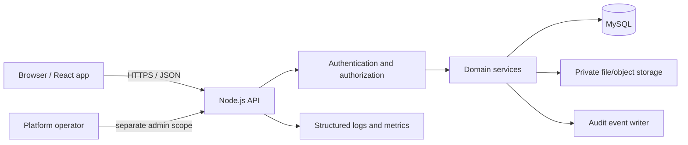
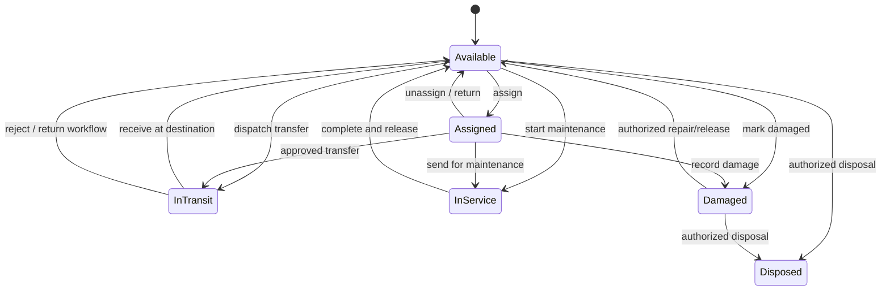

# AssetMov Architecture and Security

## 1. Product shape

AssetMov is a browser-based multi-tenant asset lifecycle application. React is the presentation layer; Node.js serves a versioned API; MySQL is the durable relational store. Business rules belong in backend services, never only in frontend components.



## 2. Suggested technology baseline

- Frontend: React, TypeScript, Vite, accessible component primitives, React Router, a query/cache layer for API state, and schema-based form validation.
- Backend: Node.js, TypeScript, Express, Zod (request/environment validation), structured logging, centralized error handling and API versioning.
- Database: MySQL 8.x-compatible schema, Prisma ORM/migrations.
- Tests: unit tests for domain rules, integration tests using a disposable MySQL database, browser tests for critical workflows.
- Delivery: local Docker Compose for MySQL, CI for lint/typecheck/tests/migration checks, reproducible deployment and backup/restore drills.

Versions should be pinned and security-reviewed when the implementation scaffold is generated.

## 3. Repository layout

```text
assetmov/
  frontend/
    src/
      app/             routes and app shell
      features/        assets, locations, transfers, requests, reports...
      components/      shared, accessible UI
      lib/             API client, validation, formatting
  backend/
    src/
      config/          validated environment
      middleware/      auth, tenant context, permissions, errors
      modules/         domain modules
      services/        cross-module business rules
      repositories/    database access
      app.ts
      server.ts
    prisma/
      schema.prisma
      migrations/
    tests/
  docs/
```

The initial implementation can start modular-monolith style: one API and one database, clear module boundaries. Do not split into microservices before load and operational needs justify it.

## 4. Tenant-isolation design

### Tenant identity

- Every customer organization is a `Tenant`.
- A user can belong to multiple tenants through a `Membership`; role is scoped to that membership.
- The API resolves active tenant context from an authenticated membership and an explicit, validated tenant selection mechanism.
- A client-supplied `tenantId` in a JSON body is not authorization. Never trust it to scope reads or writes.
- All tenant-owned records use a non-null tenant key and indexed tenant-scoped access paths.
- Use tenant-aware uniqueness (for example `UNIQUE(tenant_id, inventory_number)`) rather than global uniqueness unless the field is intentionally global.

### Enforce at multiple levels

1. Authentication middleware establishes the user.
2. Tenant-context middleware verifies membership and builds a trusted context.
3. Permission policy checks role/action and optional location scope.
4. Service/repository APIs require tenant context and include it in every query/update/delete/export.
5. Database constraints and composite uniqueness prevent common cross-tenant inconsistencies where practical.
6. Tests create two tenants with similar IDs/data and attempt cross-tenant read, update, delete, import, export, and file access.

Location scope is additional to tenant scope, not a substitute for it. Platform-admin operations must use explicit platform-admin policies and be audited.

## 5. Roles (initial proposal)

These are starting product roles, not a claim that the old application's role names match exactly.

| Role | Typical capabilities |
|---|---|
| Platform administrator | Manage tenants, platform health and subscription/support operations; no routine customer-data browsing without a justified audited support path. |
| Tenant owner | Manage organization, settings, members, and tenant-wide policy. |
| Tenant administrator | Manage tenant setup, user access and master data. |
| Asset manager | Register/edit assets, assign, transfer, service and generate reports as permitted. |
| Location manager | Operate within assigned locations/subtrees; receive/dispatch assets and participate in audits. |
| Approver | Decide assigned requests and selected workflow approvals. |
| Auditor / read-only | Read permitted registers, timelines, reports and audit evidence; no state-changing operations. |
| Employee / custodian | View assigned assets and submit requests/acknowledgements allowed by tenant policy. |

Prefer explicit permission keys such as `asset.read`, `asset.create`, `asset.financial.update`, `asset.assign`, `transfer.dispatch`, `transfer.receive`, `request.approve`, `asset.dispose`, `audit.signoff`, `report.export`. Frontend visibility is UX only; the API authorizes each operation.

## 6. Domain boundaries and core records

- **Identity:** User, Tenant, Membership, invitations, sessions, reset/verification state.
- **Organization:** locations and their parent-child hierarchy; employee/custodian records and location assignments.
- **Configuration:** categories, asset models, typed custom-field definitions, supplier/manufacturer, numbering policy and tenant preferences.
- **Inventory:** asset, asset identifiers/tags, current-state projection and append-only asset transactions.
- **Movement:** transfer/issue document, transfer lines, acceptance/rejection, receipt/GRN and movement ledger.
- **Requests:** request, request lines, approval/decision history and fulfillment link.
- **Maintenance:** service work order, dates, costs, outcome, provider and linked asset.
- **Software:** software type, entitlement/license, seat/assignment and expiry.
- **Audit:** physical audit session, expected snapshot, scans/findings, reconciliation decision.
- **Reporting:** permission-scoped report queries and export jobs.
- **Platform SaaS (later milestone):** plan, subscription, asset/user/storage usage, billing events and tenant lifecycle.

Every important action should write its business change and audit event in a single database transaction where possible.

## 7. Asset lifecycle and movement invariants

Represent current status/location for quick read, but preserve history in immutable transactions. The service layer must validate transitions, for example:

- Disposed assets cannot be assigned or transferred.
- An asset cannot be in two active employee assignments or two in-transit transfers at once.
- Assets marked in maintenance are unavailable for regular checkout unless a permitted override is recorded.
- Dispatch reserves the selected assets and records origin/destination; receipt records acceptance and destination state.
- Damage, disposal, assignment, unassignment, service start/completion, upgrades and corrections include actor/time/reason where applicable.
- High-contention movement operations lock or version-check asset rows to prevent race conditions.
- Bulk operations return per-item results and must have documented atomicity; all-or-nothing is preferred for transfer creation.



Exact states and transitions must be refined during domain implementation. Software licenses and upgrade relationships have their own lifecycle rules.

## 8. Security baseline

- Hash passwords with a modern password-hashing algorithm (Argon2id where deployment supports it); never store plaintext or reuse legacy hashes automatically.
- Prefer secure, HttpOnly, SameSite cookies for browser sessions, with session rotation and CSRF protection when cookie-authenticated mutation endpoints are used. Never put long-lived tokens in localStorage.
- Enforce TLS; configure trusted proxy settings deliberately; set secure headers; limit request body sizes and rate-limit login/reset/upload endpoints.
- Validate every request with explicit allow-listed schemas; reject unknown/invalid fields where practical.
- Use parameterized ORM/database operations; do not concatenate user input into SQL.
- Apply object-level authorization on every asset/document/report/file ID to prevent IDOR.
- Check MIME type, extension, actual file content/size, and malware policy for uploaded files; store private files outside the public web root and authorize every download.
- Redact secrets/credentials and unnecessary employee/personally identifiable fields from logs and audit diffs.
- Use least-privilege database credentials, secret manager/environment configuration, dependency updates, backup encryption, tested restore procedures and incident logging.
- Consider MFA, SSO, SCIM, retention controls, data export/deletion, and regional hosting based on target customer requirements.

## 9. Audit and operational integrity

Audit events should include tenant, actor, action, entity type/id, timestamp, request/correlation ID, source IP when appropriate, and redacted before/after values. Application users must not be able to edit/delete audit history through ordinary APIs. Treat append-only application behavior as a minimum; stronger database/retention protections can be added for regulated customers.

Critical operations (asset movement, disposal, approvals, user/role changes, imports, audit sign-off) should be observable and reconstructable. Use structured logs and metrics but do not log passwords, reset tokens, session cookies, or complete sensitive payloads.

## 10. SaaS billing and onboarding

Separate core inventory from billing concerns. The platform should eventually support tenant signup/invitation, verified owner account, organization setup wizard, trial/subscription state, asset/user/storage limits, payment-provider webhooks with signature verification/idempotency, invoices and cancellation/export policy. Do not make billing a dependency for developing the core asset workflows.

## 11. Import and migration strategy

1. Obtain an authorized export for the specific customer and establish who approved its use.
2. Profile data without copying real records into git/issues/logs.
3. Map legacy tables and status codes to the new normalized schema.
4. Import reference/master records first, then employees/locations, assets, current assignments, transactions/transfers, requests, service/licensing history and audit data in dependency order.
5. Use staging tables or import jobs with row-level validation, idempotency keys and duplicate reports.
6. Do not migrate passwords/sessions/activation tokens blindly. Invite users to establish new credentials.
7. Reconcile row counts, per-location asset counts, key financial totals and lifecycle states with authorized owners before cutover.
8. Preserve a rollback and read-only legacy reference plan, then cut over during an approved window.

## 12. Quality gates

A milestone is not complete because a page renders. It needs domain unit tests, API integration tests, tenant-isolation/permission tests, migration checks, meaningful loading/empty/error states, keyboard accessibility, responsive layout, logging/redaction review, and documented acceptance criteria.


## 13. SaaS administration boundaries — required product rule

AssetMov serves multiple independent customer companies. There are two separate authority scopes: **Platform Super Admin** and **Company Admin / tenant owner**. The first registered user becomes the initial admin of that one tenant, not a platform operator.

- Platform administration is a separate protected area and permission scope for tenant lifecycle, plans and the four resource limits, subscription/support operations, platform staff and service health.
- Company Admin manages only its own tenant: company profile/preferences, users/memberships, custom roles and their permission grants, location hierarchy and user/location scopes, categories/models/custom fields, numbering, suppliers/manufacturers and all company asset workflows.
- The platform defines valid permission keys; company admins assemble tenant roles from the allowed catalogue. They cannot create arbitrary backend privilege keys or grant platform permissions.
- Company-admin authority never makes tenant IDs trustworthy and does not relax tenant/location checks. Platform-admin access must use explicit platform policies and must be audited.
- Role changes must prevent privilege escalation and lockout, including protecting the last tenant owner/admin and auditing role/scope changes.
- Subscription rules do not replace user permissions: the subscription must be valid, any relevant asset/user/storage limit must permit the operation, the user must have permission, and location scope must allow it where applicable. All application features remain available across plans.

See [SAAS_PRODUCT_REQUIREMENTS.md](SAAS_PRODUCT_REQUIREMENTS.md) for detailed flows, tenant-configurable fields, module scope and acceptance criteria. All subsequent modules should satisfy that document before being considered complete.


## 14. Simple subscription plans and quota safety

Follow [SUBSCRIPTION_GUARDRAILS.md](SUBSCRIPTION_GUARDRAILS.md). Keep subscription enforcement small: the only commercial limits are maximum assets, maximum active users, storage bytes and trial duration. Application feature availability is the same across plans.

For company-owned operations:
1. Authenticate the actor and resolve the trusted tenant membership.
2. Resolve subscription status, plan and server-stored trial end.
3. For operations that increase usage, check the relevant asset, active-user or storage limit.
4. Check role permissions and location scope.
5. Validate domain rules, then commit the operation and any quota reservation atomically.
6. Record audit events for plan changes and privileged exceptions.

Architecture requirements:
- Keep tenant lifecycle and subscription/payment state separate.
- The Plan configuration only needs identity, active status, asset cap, active-user cap, storage cap and trial duration where applicable.
- Tenant subscription data keeps selected plan, lifecycle status, trial timestamps and paid-period/provider fields as the billing model matures.
- Enforce the same limits in APIs, imports, bulk actions, user invites/reactivations, file uploads and background jobs.
- Protect concurrent asset/user creates and storage uploads using transaction-safe checks, conditional writes or reservations. Release reservations on failure and make retries idempotent.
- At quota, block only net-new consumption; do not make current company records inaccessible or silently delete data during downgrade.
- Platform Super Admin controls plan values and approved overrides. Company Admin can view usage and plan details, but cannot directly mutate plan assignment or counters.
- Do not trust browser-provided limits, usage, file sizes, trial timestamps or subscription status. Verify provider webhooks when introduced.
- Keep platform-wide security/abuse limits independent of the commercial plan.
- Test quota boundaries, concurrent requests, trial expiry, downgrade-over-limit behavior and cross-tenant isolation before acceptance.
